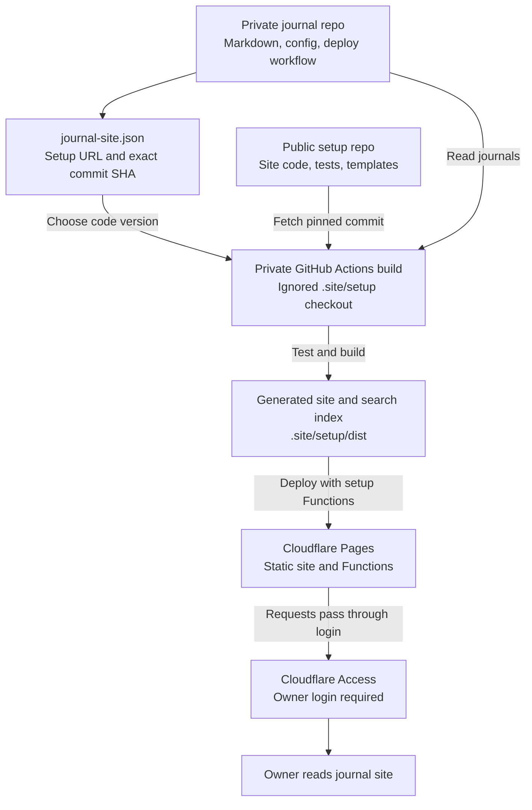

# How Two Repos Work

Public repo holds reusable site code. Private repo holds your journals and picks which code version to run. Private build combines both, then deploys site behind Cloudflare Access.

## Build flow

No journal content goes into public setup repo. Generated pages contain private content too, so `.site/` stays ignored and deployed hosts need Access protection.

## What lives where

| Place | Holds | Who can read |
| --- | --- | --- |
| Public setup repo | Renderer, styles, archive API code, tests, fake examples and starter files | Anyone |
| Private journal repo | Real Markdown, archives, Git history, `journal-site.json`, runner and deploy workflow | Repo collaborators |
| Private GitHub Actions secrets | Cloudflare deploy token and account ID | Authorized workflow steps |
| Cloudflare Pages runtime | Optional GitHub write token and owner auth settings | Server code, never browser code |
| Deployed site | Generated journal pages, search index and Functions | Access policy decides |

Public code does not make site private on its own. Protect custom domain, production Pages hostname and preview/deployment hosts with Cloudflare Access.

## What happens when journal changes

1. You or your existing recorder write Markdown into private repo.
2. Push to configured production branch starts private repo's GitHub Actions workflow.
3. Workflow reads `journal-site.json`. `repository` gives setup Git URL; `revision` gives full 40-character commit SHA.
4. `node scripts/site.mjs prepare` fetches that exact commit into ignored `.site/setup`. Runner checks commit, detached checkout and clean source before running setup commands.
5. Build gets private repo path through `JOURNAL_ROOT`. It reads Markdown without rewriting source and writes generated content inside setup checkout.
6. Workflow tests, checks and builds site. Wrangler runs from `.site/setup`, so `dist/` and sibling `functions/` deploy together.
7. Cloudflare serves new site. Access still requires owner login.

Site reads generated pages and search data. It does not fetch journals from GitHub on each page view. Build reads current private working tree; setup code version stays fixed by pin.

Starter deploy workflow uses `master`. If using `main`, change push trigger, job ref guard and Wrangler deploy branch together. See [demo setup YAML](../examples/setup.yml).

## What happens when setup changes

Push to public setup repo checks code with fake journals. It does not deploy private site or change private repo's pin.

To upgrade your site:

1. Review new setup commit.
2. Change `revision` in private `journal-site.json` to full commit SHA.
3. Run private runner's prepare, install, test, check and build commands.
4. Commit and push private config. Private workflow deploys new version.

Use earlier setup SHA to roll back code version. This does not roll back journal edits. Copied starter runner and workflow files stay in private repo; changing their public templates does not update existing copies. Review and copy those changes separately when needed.

## Optional Archive and Restore

Owner clicks Archive. Pages Function checks signed Access token, owner email and journal path. With production runtime secrets configured, Function moves file into `.archive/` through GitHub API in private repo. Restore moves it back. Normal private workflow then rebuilds site.

Archive code comes from public setup. Write token and target repo settings stay in Cloudflare. `journalRepository` in build JSON does not set runtime `GITHUB_REPO`; configure that separately. Without required runtime settings, archive actions stay disabled. Preview gets no write token.

## Start your own

For small repo with bootstrap inside deploy YAML, copy [demo journal repo](../examples/my-journal/). No separate scripts or tests folder needed. Inline workflow fetches and checks exact setup pin, then tests and builds. Data flow above stays same.

For separate runner with local command support, follow [README setup steps](../README.md) and copy [private starter](../templates/private/). Keep journal repo private and choose setup commit deliberately.

Diagram files: [Mermaid source](diagrams/two-repo-flow.mmd), [SVG](diagrams/two-repo-flow.svg), [PNG](diagrams/two-repo-flow.png), [editable scene](diagrams/two-repo-flow.excalidraw).
